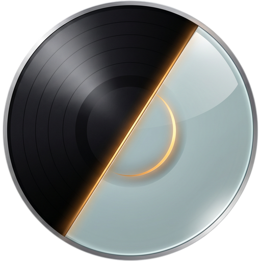
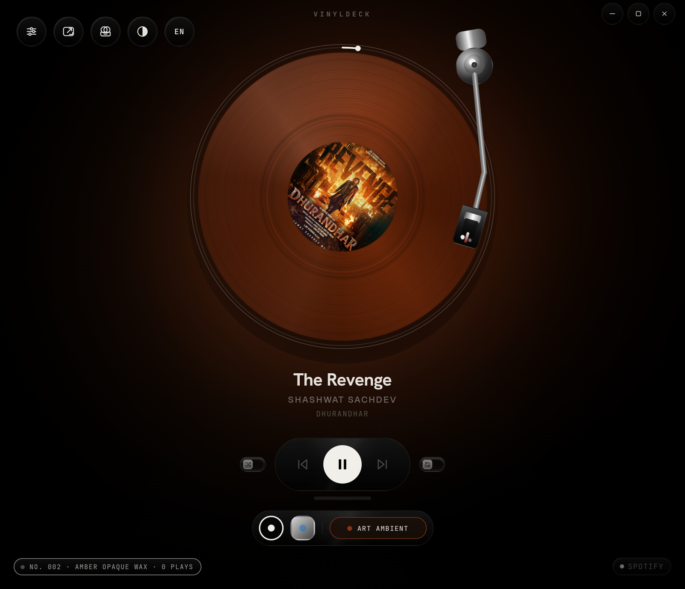
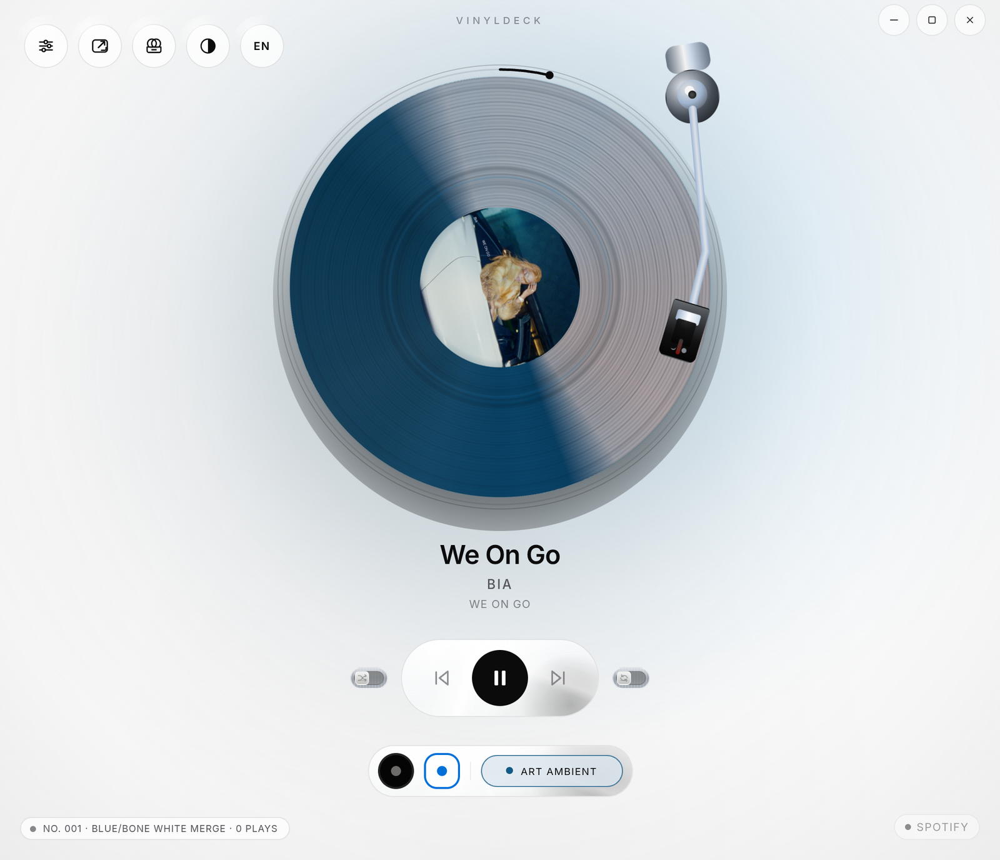
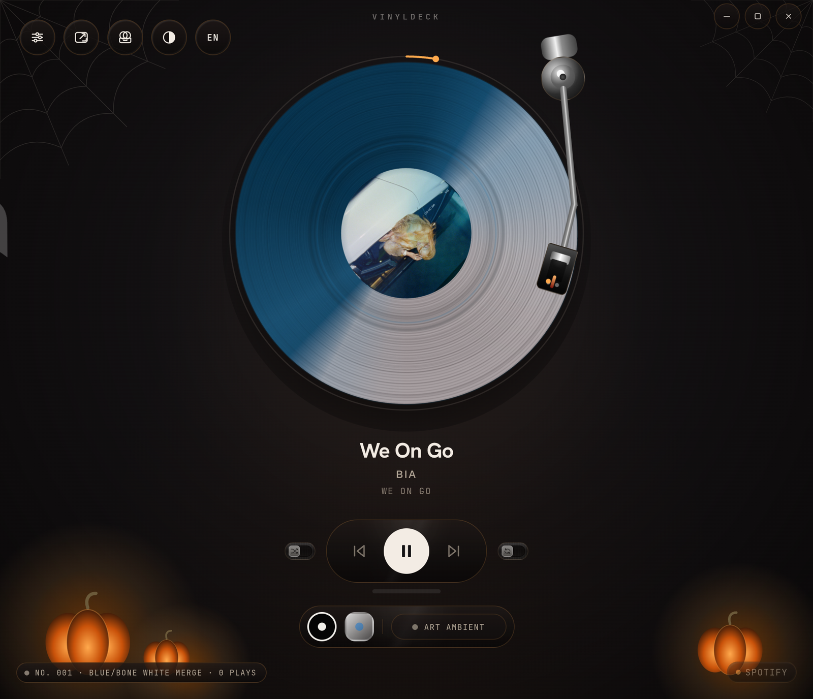
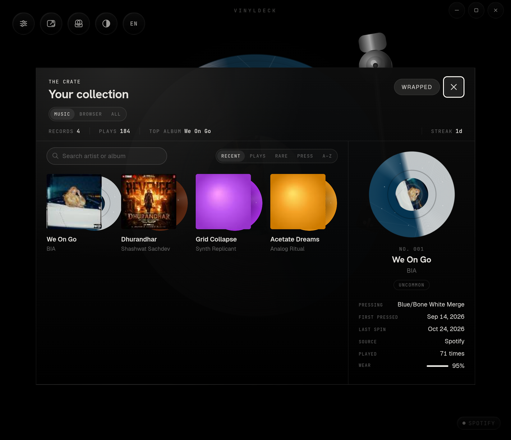
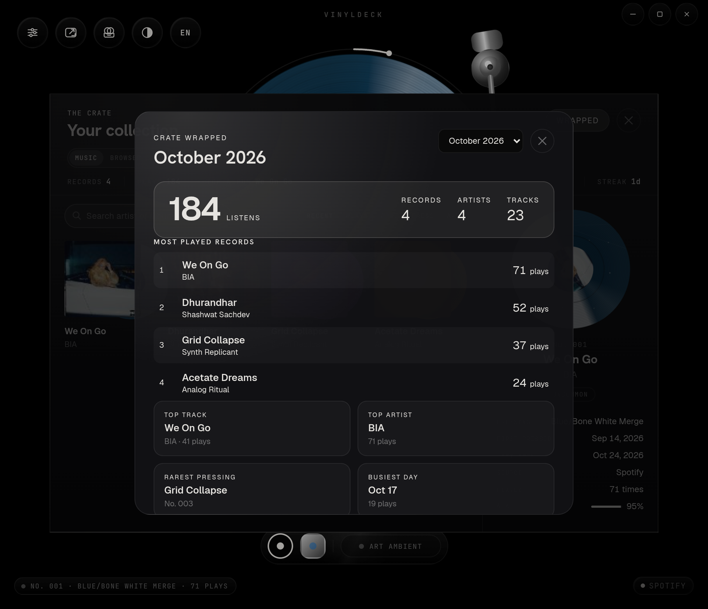
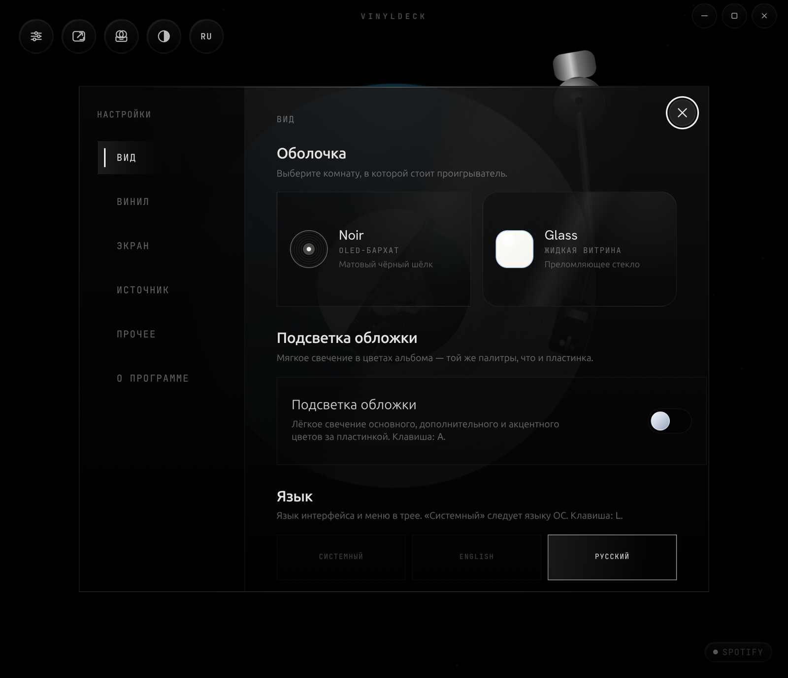
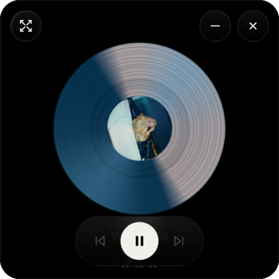

<h1 align="center">
  <br>
  VinylDeck
</h1>

<p align="center">
  <strong>Turn whatever is playing on your desktop into a living turntable.</strong><br>
  A cinematic vinyl player for Windows and Linux, built with Tauri, Rust, React and native system-media APIs.
</p>

<p align="center">
  <a href="https://github.com/Shelldock1/vinyldeck/releases/latest">
    
  </a>
  
  
  
  
  
  
</p>

<p align="center">
  <a href="https://github.com/Shelldock1/vinyldeck/releases/latest/download/vinyldeck-setup-windows-x64.exe">
    
  </a>
  <a href="https://github.com/Shelldock1/vinyldeck/releases/latest/download/vinyldeck-linux-x64.AppImage">
    
  </a>
</p>

<p align="center">
  <a href="./docs/USER_GUIDE.md">User guide</a>
  ·
  <a href="./docs/ARCHITECTURE.md">Architecture</a>
  ·
  <a href="./docs/DEVELOPMENT.md">Development</a>
  ·
  <a href="./CONTRIBUTING.md">Contributing</a>
  ·
  <a href="./CHANGELOG.md">Changelog</a>
</p>

VinylDeck does not stream music and does not need your library. Start a track in Spotify, a browser, VLC, mpv or anything else that talks to Windows SMTC or Linux MPRIS, open VinylDeck, and the active session becomes the deck. Album art is pressed into the record label, its palette lights the room, the tonearm follows the song, and every control acts on the real player.

<p align="center">
  
</p>
<p align="center">
  
  
</p>
<p align="center">
  
  
</p>
<p align="center">
  
  
</p>
<p align="center"><sub>Noir with Art Ambient · Light and Halloween schemes · The Crate and Wrapped · Russian localization · Mini player</sub></p>

## Install

### Windows 10/11 (x64)

One line in PowerShell:

```powershell
irm https://github.com/Shelldock1/vinyldeck/releases/latest/download/install.ps1 | iex
```

The script downloads the NSIS setup, verifies its SHA-256 when the release publishes one, installs for the current user (no admin prompt), adds the app folder to your user `PATH`, and keeps a Start Menu shortcut.

Prefer a manual download? Use the **Download for Windows** badge above, or pick an asset on the [latest release](https://github.com/Shelldock1/vinyldeck/releases/latest):

| File | What it is |
| --- | --- |
| `vinyldeck-setup-windows-x64.exe` | NSIS installer, current user |
| `vinyldeck-windows-x64.msi` | MSI for machine-wide deployment |

Windows needs the [WebView2 runtime](https://developer.microsoft.com/microsoft-edge/webview2/). Windows 10/11 already ship it; the installer bootstraps it when it is missing.

### Linux (x64)

One line in a terminal:

```bash
curl -fsSL https://github.com/Shelldock1/vinyldeck/releases/latest/download/install.sh | bash
```

This installs the AppImage to `~/.local/bin/vinyldeck`, adds a desktop entry and icon, and puts the directory on `PATH` for future login shells. No sudo is used. Set `VINYLDECK_INSTALL_DIR` to choose another location.

Manual options from the [latest release](https://github.com/Shelldock1/vinyldeck/releases/latest):

| File | What it is |
| --- | --- |
| `vinyldeck-linux-x64.AppImage` | Portable single file (`chmod +x` and run) |
| `vinyldeck-linux-x64.deb` | Debian/Ubuntu package (`sudo apt install ./vinyldeck-linux-x64.deb`) |

The Linux build needs GTK 3, WebKitGTK 4.1 and an AppIndicator host. On Debian/Ubuntu:

```bash
sudo apt install libwebkit2gtk-4.1-0 libayatana-appindicator3-1 librsvg2-2
```

System-audio reactivity additionally reads the PipeWire/Pulse monitor through `parec`; install `pulseaudio-utils` (or the PipeWire Pulse compatibility package) if it is missing.

Both installers understand `VINYLDECK_VERSION` (for example `v0.2.0`) to pin a release, and both print an actionable error on unsupported architectures. Only x64 builds are published today.

## Features

### Playback

- **Native system media** - Windows SMTC and Linux MPRIS, with artwork, metadata, timeline, capabilities and transport commands.
- **Player picker** - follow the active session automatically or pin a specific app (Spotify, a browser, VLC, mpv, ...); the choice survives restarts.
- **Real controls** - play/pause, previous/next and seek when the source supports them, plus shuffle and repeat (`Off -> All -> One`) where exposed.
- **Needle Drop** - drag the tonearm across the grooves to seek with a live time preview, or lift it off the record to pause.
- **Sleep timer** - pause after 15/30/45/60 minutes or at the end of the current track. The timer lives in Rust, so switching modes does not reset it.
- **Global shortcuts** - `Ctrl+Alt+M` toggles Mini and `Ctrl+Alt+Space` toggles playback from any app.

### The deck

- **Two shells, three schemes** - Noir and Glass, each layered with Light, Dark or Halloween tokens.
- **Pressed records** - album art drives a deterministic vinyl pressing (marble, splatter, clear, smoke, galaxy and more), with wear that grows across listens.
- **Cinematic motion** - tonearm cueing, directional track changes, film grain, vinyl wobble and optional album-art ambient bloom.
- **Three window modes** - Main (scales to fit the window), Fullscreen, and a shrinkable always-on-top Mini player.
- **Mini transparency** - native Acrylic blur on Windows (desktop transparency on Linux compositors that support it).
- **Reactive deck** - a three-band VU meter, tonearm jitter and groove glow fed by WASAPI loopback on Windows or the PipeWire/Pulse monitor on Linux. No microphone is opened.

### Collection and extras

- **The Crate** - every album you play becomes a numbered pressing with rarity, play count and visible wear. Search, sort (recent, plays, rare, pressing, A-Z), filter music apps vs browsers, and see totals, top album and listening streak.
- **Crate Wrapped** - a monthly recap with total listens, unique records/artists/tracks, top five records, top track/artist, rarest pressing and busiest day.
- **OBS overlay** - a transparent, self-refreshing browser source at `http://127.0.0.1:43110/overlay`, plus `/state` JSON and `/artwork`. The server is localhost-only and rejects foreign `Host` headers.
- **Discord Rich Presence** - opt-in: paste your own Discord application client ID in Settings and VinylDeck mirrors the track and elapsed time over the local IPC socket.
- **English and Russian** - every screen, tooltip, screen-reader label and tray menu, with correct plurals and locale-aware dates. Auto follows the OS.
- **Desktop citizenship** - tray lifecycle, quit-to-tray, start-at-login, single-instance focus, persistent settings, a manual update check and a strict CSP.

## Usage

1. Start playback in your player.
2. Open VinylDeck. The active system session appears on the deck.
3. Use the in-app controls, the tonearm, or the shortcuts below. The tray menu and global hotkeys work while another app has focus.

Shortcuts can be disabled in Settings; `Escape` remains available for closing the topmost surface. See the [User Guide](./docs/USER_GUIDE.md) for the Crate, Wrapped, overlay, Discord, sleep timer and settings.

## Controls

| Action | Shortcut |
| --- | --- |
| Play / pause | `Space` |
| Play / pause (global) | `Ctrl+Alt+Space` |
| Previous / next | `Left` / `Right` |
| Seek -5s / +5s | `Shift+Left` / `Shift+Right` (or arrows with the progress ring focused) |
| Fullscreen | `F` |
| Mini player | `M` |
| Mini player (global) | `Ctrl+Alt+M` |
| Cycle shell | `T` |
| Settings | `S` |
| Art Ambient | `A` |
| The Crate (your collection) | `C` |
| Switch language (English / Русский) | `L` |
| Show keyboard shortcuts | `?` |
| Close the topmost surface | `Escape` |
| Quit | `Ctrl+Q` |

## Build from source

Requirements:

- [Node.js](https://nodejs.org/) 20 or newer (CI uses 24) and npm
- [Rust](https://rustup.rs/) stable
- Platform toolchain:
  - **Windows**: Visual Studio Build Tools with the "Desktop development with C++" workload, plus WebView2 (present on Windows 10/11).
  - **Linux**: GTK 3 / WebKitGTK 4.1 development packages.

Clone and run:

```bash
git clone https://github.com/Shelldock1/vinyldeck.git
cd vinyldeck
npm ci
npm run tauri dev
```

Browser-only visual development uses the mock playback source (no native APIs):

```bash
npm run dev
```

### Windows

```powershell
npm run tauri dev
npm run tauri build -- --bundles nsis,msi
npm run install:windows   # build + install for the current user
```

Outputs land in `src-tauri\target\release\bundle\nsis\` and `...\msi\`. `install:windows` copies the binary to `%LOCALAPPDATA%\Programs\VinylDeck` and writes a Start Menu shortcut; add `-SkipBuild` after a build to reuse it.

### Linux

Install the Tauri dependencies (Debian/Ubuntu):

```bash
sudo apt install build-essential curl wget file libssl-dev libxdo-dev \
  libwebkit2gtk-4.1-dev libayatana-appindicator3-dev librsvg2-dev pkg-config
```

Then:

```bash
npm run tauri dev
npm run tauri build -- --bundles deb,appimage
npm run install:linux    # build + install into ~/.local/bin
```

Outputs land in `src-tauri/target/release/bundle/deb/` and `.../appimage/`. If FUSE is unavailable, run the AppImage with `APPIMAGE_EXTRACT_AND_RUN=1`. Rootless or container setups can point `pkg-config` at a local sysroot; see the [Development Guide](./docs/DEVELOPMENT.md).

### Release packaging

`node scripts/collect-release.mjs <windows|linux>` maps the bundle output to the version-free names used by `releases/latest/download`:

```text
vinyldeck-setup-windows-x64.exe
vinyldeck-windows-x64.msi
vinyldeck-linux-x64.AppImage
vinyldeck-linux-x64.deb
```

Pushing a `v*` tag runs [`.github/workflows/release.yml`](./.github/workflows/release.yml), builds both platforms, writes `SHA256SUMS.txt` and publishes the release. See [docs/RELEASING.md](./docs/RELEASING.md) for the full process.

## Verification

```bash
npm run lint
npm run build
npm run test:frontend
npm run fmt:rust
npm run clippy:rust
npm run test:rust
```

CI runs the frontend, Rust and bundle checks on Ubuntu and Windows for every push and pull request.

## Project layout

| Path | Purpose |
| --- | --- |
| `src/` | React 19 visual engine, views, hooks and stores |
| `src-tauri/src/media/` | SMTC / MPRIS adapters, poller, artwork cache |
| `src-tauri/src/` | Settings, tray, window, collection, overlay, presence, reactivity, sleep, shortcuts |
| `src-tauri/tauri.conf.json` | Window, CSP and bundle configuration |
| `scripts/` | Local installers and release packaging |
| `docs/` | User, development, architecture, API and release documentation |
| `landing/` | Optional marketing site (Netlify) |

## Troubleshooting

- **Nothing on the deck** - start playback after VinylDeck opens and confirm the player appears in the OS media controls. Browser mode (`npm run dev`) intentionally shows mock tracks.
- **Controls greyed out** - the active player does not expose that capability. Try the same action in the player itself or switch sources in Settings -> Source.
- **No audio reactivity** - install `pulseaudio-utils` on Linux; on Windows confirm the app is playing through the default output device. Failures leave the deck still rather than opening a microphone.
- **Mini transparency does nothing** - it is Mini-only. Blur requires Windows Acrylic; on Linux it depends on the compositor.
- **App hides instead of exiting** - disable Settings -> Other -> Quit To Tray, use tray -> Quit, or press `Ctrl+Q`.
- **SmartScreen or "Unknown publisher"** - release binaries are not code-signed yet. Verify the SHA-256 from the release page if you want to confirm the download.
- **AppImage will not start** - install FUSE/libfuse2 or run with `APPIMAGE_EXTRACT_AND_RUN=1`.

More in [Troubleshooting](./docs/TROUBLESHOOTING.md).

## Privacy

VinylDeck has no telemetry and no account. Media metadata is read locally. The OBS overlay listens on `127.0.0.1:43110` only. Discord Rich Presence is off until you supply your own application client ID.

## Credits

VinylDeck is based on the original [VinylDeck](https://github.com/ItsRudraksh/vinyldeck) by [ItsRudraksh](https://github.com/ItsRudraksh), who built the Tauri foundation, the vinyl engine and the Noir/Glass shells. This repository is maintained by [Shelldock1](https://github.com/Shelldock1) and continues that work with cross-platform media, the Crate, localization, accessibility and the Windows/Linux distribution pipeline.

## License

[MIT](./LICENSE). Fonts under `public/fonts/` ship with their own SIL Open Font License files. Runtime album artwork belongs to its rights holders. The demo art in `public/art-1.jpg` and `public/art-2.jpg` is sample media and is not covered by the MIT license.
