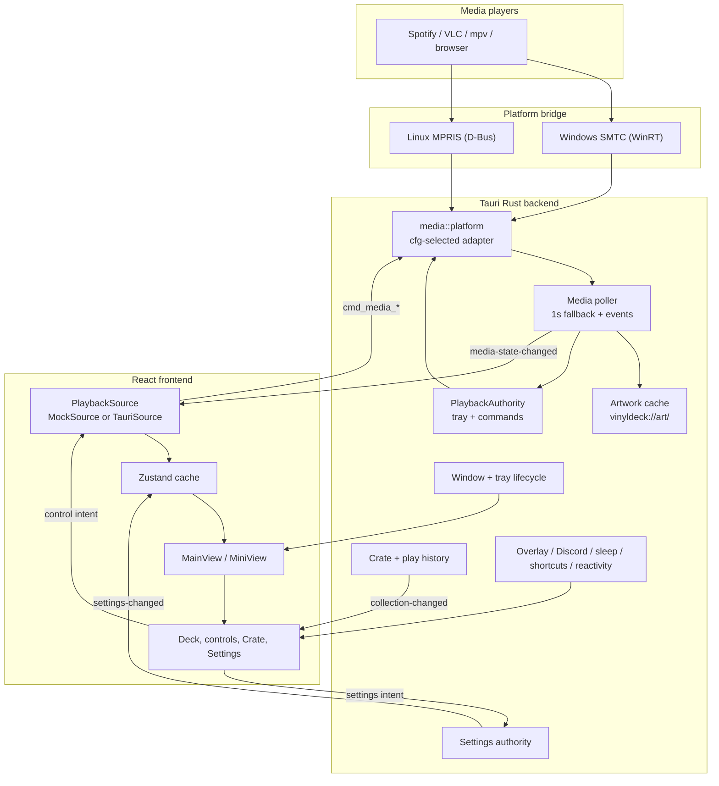
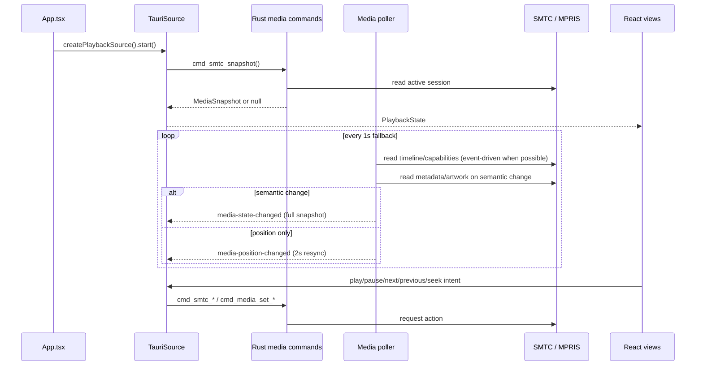
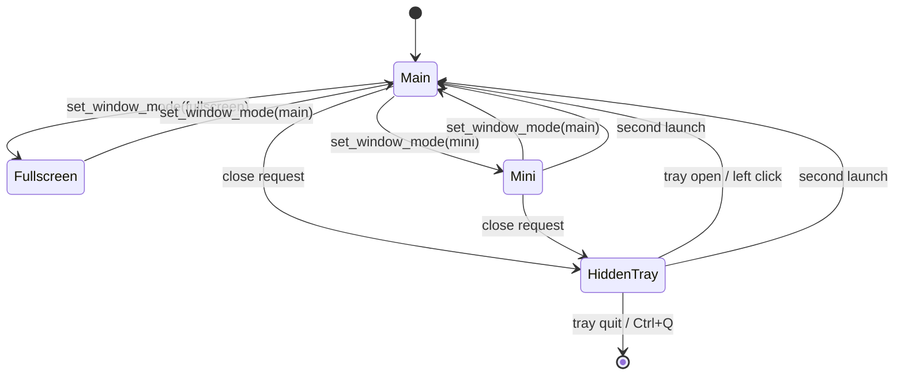

# VinylDeck Architecture

VinylDeck is one React visual engine over one Rust backend with thin platform adapters. Windows talks to SMTC (WinRT), Linux talks to MPRIS over D-Bus, and unsupported targets get explicit "nothing playing" stubs. The UI never branches on the operating system.

The central rule: **React renders; Rust owns native integration, durable state and real media access.**

## System overview

## Platform adapters

| Concern | Windows | Linux | Shared code |
| --- | --- | --- | --- |
| Media sessions | `media/smtc.rs` (WinRT, AUMID) | `media/linux.rs` (`zbus`, bus names) | `media/model.rs`, `poller.rs`, `authority.rs`, `commands.rs` |
| Session picker | `cmd_media_players` | `cmd_media_players` | `src/lib/media/players.ts` |
| Artwork | WinRT thumbnail stream | MPRIS `mpris:artUrl`, `data:` URLs | `artwork.rs` cache + URI scheme |
| Audio reactivity | `reactivity/windows.rs` (WASAPI loopback) | `reactivity/linux.rs` (`parec`) | `reactivity/dsp.rs` three-band envelope |
| Discord IPC | named pipe | Unix socket (`XDG_RUNTIME_DIR`, `TMPDIR`, Flatpak path) | `presence.rs` worker |
| Autostart | registry Run key | XDG autostart entry | `tauri-plugin-autostart` |
| Tray | native tray | native tray | `tray.rs` |
| Other targets | - | - | `media/unsupported.rs` |

`media/platform.rs` re-exports the right adapter, so the poller and commands stay platform-neutral.

## Playback flow

- Linux subscribes to MPRIS `PropertiesChanged` and D-Bus `NameOwnerChanged`; Windows subscribes to SMTC session/media/timeline events.
- Transport commands wake the poller immediately instead of waiting for the next tick.
- The poll interval is a fallback for position and play counting, not the primary update path.
- Artwork is read off the polling thread. A new track's metadata and controls appear first; the cover follows.
- Covers are cached and exposed as `vinyldeck://art/<hash>`; the frontend converts that to the platform URL form at the edge.
- Play counts are emitted by the poller after half the track or 120 seconds of playing time, whichever comes first. Tracks under 30 seconds never count.

## State ownership

| State | Authority | Frontend role |
| --- | --- | --- |
| Playback in browser dev | `MockSource` | Visual development only |
| Playback in Tauri | Platform bridge through Rust | Render cache and command intent |
| Persisted settings | Rust settings authority (`tauri-plugin-store`) | Optimistic UI plus approved snapshots |
| The Crate | Rust collection state (`collection.json`) | Render and press intent |
| Play history / Wrapped | Rust collection state | Query by month and source |
| Sleep timer | Rust (`sleep.rs`) | Start/cancel and render status |
| Runtime QA flags | Zustand | Local only |
| Window mode and lifecycle | Rust window/tray modules | Request mode changes |
| Theme application | CSS custom properties | Apply approved settings |

Settings updates are validated, clamped and persisted by Rust. `cmd_settings_update` holds the lock across the whole read-modify-write, so Main and Mini cannot overwrite each other. WebViews are views and controllers, never durable storage authorities.

## Persistence

| File | Location | Owner |
| --- | --- | --- |
| `settings.json` | Tauri app data directory | Settings authority |
| `collection.json` | Tauri app data directory | Collection state |

Schema versions migrate forward. Unknown or legacy theme values are normalized rather than rejected.

## Services

- **Overlay** (`overlay.rs`): a localhost HTTP server on `127.0.0.1:43110` serving `/overlay`, `/state` and `/artwork`. It rejects foreign `Host` headers and sends no wildcard CORS header.
- **Discord presence** (`presence.rs`): a worker that mirrors playback over the local IPC socket, only when a user-supplied application ID is configured and the track or play state changes.
- **Audio reactivity** (`reactivity/`): a supervised capture thread that starts and stops with playback, emits three-band levels at roughly 30 Hz and falls back to silence on failure. No microphone is opened.
- **Sleep timer** (`sleep.rs`): Rust-owned timers that pause through the normal media bridge and emit `sleep-timer-changed` / `sleep-timer-fired`.
- **Global shortcuts** (`shortcuts.rs`): best-effort registration of Mini and play/pause hotkeys; a conflict is logged, not fatal.
- **Single instance**: `tauri-plugin-single-instance` is registered first; a second launch focuses the existing window and exits.

## Window and lifecycle model

- Main and fullscreen reuse the `main` window.
- Main is fitted to at most 92% of the monitor working area at launch; the React deck scales to the resulting viewport.
- Mini is a separate frameless, always-on-top WebView, docked to the bottom-right working area, capped at 280x280 with a 140x140 floor.
- Mini Transparency is applied only to that window. Windows uses Acrylic; Linux relies on compositor transparency.
- Close requests hide to tray when `quitToTray` is on; otherwise they request an explicit quit.
- A second launch unminimizes and focuses main, or follows the tray Open path from Mini/tray.

## Security

- Bundled builds use a Content Security Policy: `default-src 'self'`; images from `self`, `data:`, `blob:` and the artwork scheme; inline styles only; scripts from `self`; IPC through `connect-src`.
- Tauri capabilities in `src-tauri/capabilities/default.json` scope plugin permissions.
- The overlay server is loopback-only and host-allowlisted; it is read-only.
- Discord presence is opt-in and disabled while the client ID is empty.
- No telemetry, analytics or remote code is bundled.

## Implementation boundaries

- Real in-app playback uses the platform bridge commands; browser mode remains mock-only by design.
- The CSS/DOM vinyl renderer is active. WebGL code remains a dormant experiment behind a hardcoded-off flag.
- Shortcut editing, a splash screen and code signing are not implemented.
- Only x64 Windows and Linux artifacts are published.
- `.agents/memory/` is internal and is not part of the product contract.
