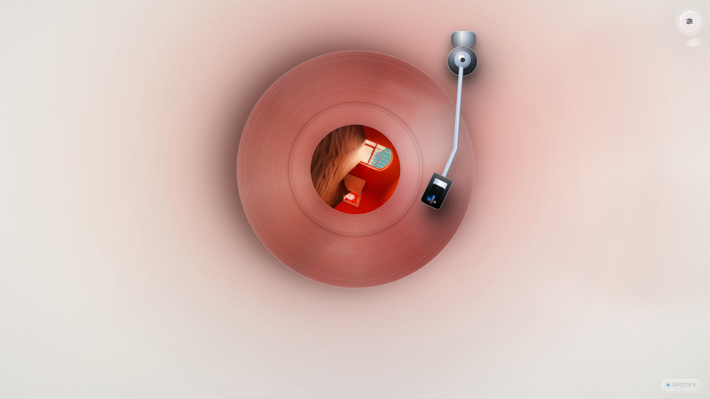
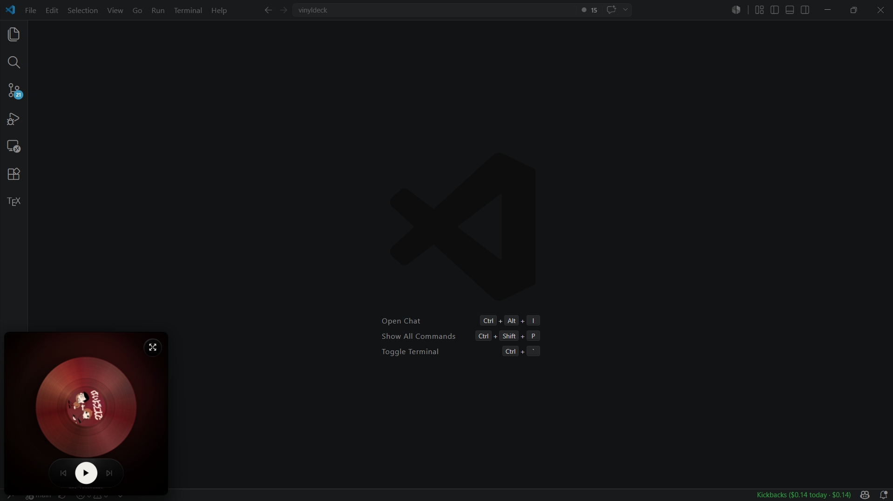
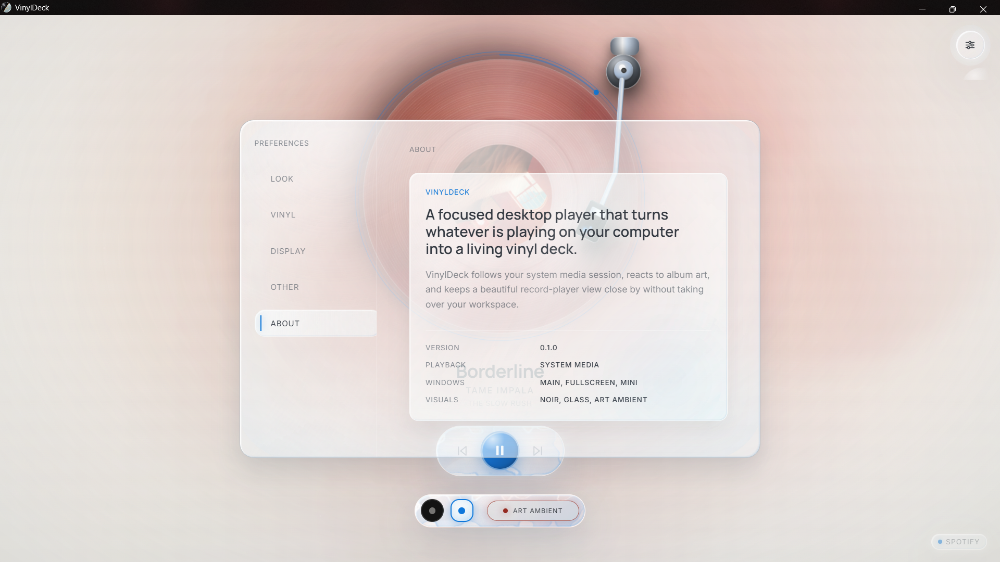

# User Guide

This guide covers using VinylDeck as a desktop companion for music already playing on Windows.

## Starting The App

Run VinylDeck in desktop mode:

```powershell
npm run tauri dev
```

Start playback in a Windows media app such as Spotify, a browser, or VLC. VinylDeck listens to the active system media session and renders the current track as a vinyl deck.

Browser development mode is available with mock playback:

```powershell
npm run dev
```

## Main Player

The main view combines:

- animated vinyl record with album art
- physical tonearm
- track title, artist, and album
- progress ring and seek support when the source allows it
- play/pause, previous, and next controls
- shuffle and repeat levers when the source supports them
- shell picker
- source badge

Controls automatically disable when the active media source does not support that action.

### Shuffle and Repeat

Two small metal levers sit beside the transport pill. Shuffle flips on and off. Repeat cycles Off -> All -> One -> Off, and the tiny `1` engraved on the lever marks repeat-one. If the active source does not report shuffle or repeat support, its lever is hidden. The same states are available from the tray menu while VinylDeck is minimized to the tray.

### Needle Drop

The tonearm follows the track: it starts at the outer groove and creeps toward the label as the song plays. Grab the headshell to cue it yourself:

- drop it anywhere on the grooves to jump there (playback starts if it was paused); the progress ring previews the landing time while you drag
- drop it beyond the record's rim to lift it onto its rest and pause

Pausing from the controls lifts the arm in place, like a cue lever. Sources with unknown duration keep the arm at a fixed playing position.

## Window Modes

| Mode | What it does |
| --- | --- |
| Main | Standard VinylDeck desktop window |
| Fullscreen | Immersive full-window player |
| Mini | Resizable always-on-top player |

<p align="center">
  
  
</p>

Mini starts as a `280x280` always-on-top player. You can shrink it down to a compact size, but it will not expand beyond the original square. As Mini gets smaller, the vinyl and hover controls scale down with the window and track text fades away to keep the record clear. Turn on Mini Transparency in Settings -> Display to let Windows Acrylic blur your desktop through the Mini player while the vinyl and controls stay readable.

Window controls sit at the top-right; the Settings, Crate, and Mini triggers sit in a row at the top-left.

Closing app windows can keep VinylDeck in the tray when Quit To Tray is enabled. Use tray Quit or `Ctrl+Q` for explicit exit.

## The Crate

Every album you play is pressed into your collection as its own record, with the same one-of-a-kind pressing you see on the deck (marble, splatter, clear, smoke, galaxy...). The stamp in the bottom-left corner shows the record's pressing number, its name, and how many times you have played it. A brand-new album flashes **New pressing**.

- A play counts once you have heard half the track or 2 minutes, whichever comes first. Paused time does not count.
- Records wear with use: favorites slowly gather dust, hairline scuffs, and a pale ring on the label.
- Rarer pressings are graded Uncommon, Rare, or Legendary.

Open the crate with `C`, the crate button in the top-left trigger row, the right-click menu, or by clicking the stamp. Sort by recent, most played, rarest, or pressing order, and pick a record to read its pressing card. Your collection is stored locally next to your settings (`collection.json`).

## Keyboard Shortcuts

Shortcuts work while a VinylDeck window is focused.

| Action | Shortcut |
| --- | --- |
| Play / pause | `Space` |
| Previous | `Left` |
| Next | `Right` |
| Seek back / forward 5s | `Shift+Left` / `Shift+Right` |
| Fullscreen | `F` |
| Mini player | `M` |
| Cycle shell | `T` |
| Settings | `S` |
| Toggle Art Ambient | `A` |
| The Crate | `C` |
| Show keyboard shortcuts | `?` |
| Close the topmost menu, crate, or settings / leave fullscreen | `Escape` |
| Quit | `Ctrl+Q` |

Disable shortcuts in Settings -> Other. Escape remains available for closing the cheat sheet, menus, the crate, Settings, and leaving fullscreen. Press `?` in Main or Fullscreen to open the cheat sheet; Mini ignores it. Escape closes the topmost surface in this order: keyboard shortcuts, context menu, The Crate, Settings, fullscreen.

The progress ring around the record is a keyboard slider: `Tab` to it, then use `Left` / `Right` (with or without `Shift`) to seek 5 seconds, or `Home` to restart the track. While Settings or the crate is open, `Tab` stays inside it and focus returns to where you were when it closes.

Start With Windows is opt-in. When enabled, VinylDeck launches automatically after sign-in so it can sit ready while you start music normally.

## Settings

Settings persist across app windows.

<p align="center">
  
</p>

| Section | Options |
| --- | --- |
| Look | Noir and Glass visual shells |
| Vinyl | Vinyl wobble, film grain, album-art ambient lighting |
| Display | Main/fullscreen/mini, always-on-top, lean-back, cursor behavior, idle timeout, Mini Transparency |
| Source | Which media session VinylDeck follows (Auto, or a specific app) |
| Other | Keyboard Shortcuts, Quit To Tray, Start With Windows, Sleep Timer |
| About | App identity and build information |

When more than one media app is open, Settings -> Source chooses which session the deck follows. Auto (the default) follows whichever app is playing, then the last one that played, and the choice is remembered between launches.

## Context Menu

Right-click the player to open the VinylDeck command menu. It includes playback actions, Sleep 30 min, Sleep after track, Cancel sleep timer (while one is running), Art Ambient, fullscreen, mini player, Settings, Player source, and Quit. Mini mode keeps only actions that make sense for the compact window.

## Sleep Timer

Settings -> Other offers a Sleep Timer keypad: Off, 15, 30, 45, or 60 minutes, or End of track. The same 30-minute and end-of-track choices are in the right-click menu, with Cancel sleep timer while one is active. The timer runs in the backend, so switching between Main, Mini, and the tray does not reset it. When it fires, playback pauses and the tonearm lifts and parks on its rest. Timers are ephemeral and do not survive a restart.

## Visual Behavior

- Noir and Glass are the current visual shells.
- Art Ambient uses album colors to tint the atmosphere.
- Track changes triggered inside VinylDeck animate directionally.
- The record stays visually anchored and receives an in-place skip impulse.

## Troubleshooting

See [Troubleshooting](./TROUBLESHOOTING.md) for media-session detection, disabled controls, WebView2, tray, and shortcut issues.
